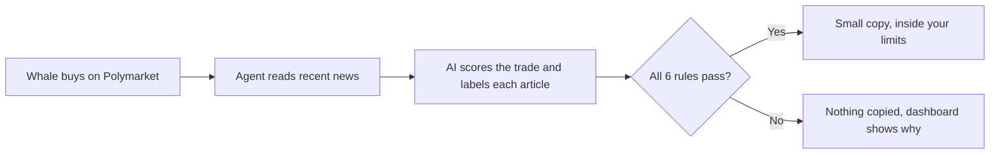

# Whalecheck

**Copy big trades only when the evidence agrees.**

Whalecheck follows a trader on [Polymarket](https://polymarket.com) and checks each of their buys against recent news and your own limits. A trade is copied only if it passes every rule, and the copy is small. It runs in dry-run mode by default, so you can watch every decision before any money moves.

## How it works



The AI gives an opinion, but it doesn't make the final call. Scraped web pages are untrusted, so fixed rules in [`validation.ts`](bot-agent/src/services/validation.ts) decide. All six must pass:

1. The whale bought, rather than sold.
2. The trade is under 2 minutes old.
3. News articles were found.
4. At least 2 different sites about this market support the outcome.
5. More sites support it than contradict it.
6. The best available price is within 2 cents of what the whale paid.

If the news service is down, nothing is copied.

## Built to handle money carefully

- **Dry run by default.** Real orders need `EXECUTION_MODE=live` and a wallet key.
- **Spending limits.** Defaults are $5 per order and $25 per day, and each trade is copied only once, even after a restart.
- **Always visible status.** Every page shows whether real money is at stake.
- **Deliberate actions.** Turning on Auto-execute asks you to confirm, and bets go through a review step that shows what you could lose.
- **No keys in the browser.** API keys stay in the server's `.env` file.
- **Payment isn't permission.** Outside agents pay through [x402](https://github.com/coinbase/x402) for a short-lived session, but only allowlisted wallets can trade.

## Run it locally

You need Node.js 20.10 or newer.

```bash
git clone git@github.com:amisilumbu07/solana_mlh.git
cd solana_mlh

(cd bot-agent && npm ci)
(cd solana-dapp && npm ci)

cp bot-agent/.env.example bot-agent/.env
```

Edit `bot-agent/.env` and set these three values:

| Setting | What it is |
|---|---|
| `TARGET_WHALE_ADDRESS` | The Polymarket wallet to follow. The all-zeros placeholder is rejected by Polymarket. |
| `FIRECRAWL_API_KEY` | Your [Firecrawl](https://firecrawl.dev) key. Without it, no trade can pass the rules. |
| `ANTHROPIC_API_KEY` | Your Claude API key. `LLM_PROVIDER` also supports `openai`, `ollama` and `gpt4free`. |

Then start the agent and dashboard:

```bash
./START_SERVICES.sh
```

Open http://localhost:3000. The agent's API runs on port 3001.

To run the tests:

```bash
cd bot-agent && npx vitest run
```

The other settings, including limits, x402 and live trading, are explained in [`bot-agent/.env.example`](bot-agent/.env.example). The agent's API routes and sign-in flow are in [`docs/bot-agent-README.md`](docs/bot-agent-README.md).

## Project status

| Part | Status |
|---|---|
| Whale trade detection from Polymarket's public API | Built |
| News checks, AI scoring and the six rules | Built, tested against simulated services |
| Dry-run decisions and spending limits | Built, tested |
| x402 sessions and access control | Built, tested against a simulated payment service |
| Live orders | Built, and signing tested against a local stand-in. **Not yet used with real funds.** |
| Markets and History pages | Sample data, labelled as such in the app |
| Polygon vault contract and Phase 3 services | Early code, not connected to the agent |

## Project layout

```
bot-agent/      Express agent: whale listener, news checks, rules, orders, x402
solana-dapp/    React dashboard (the folder name predates the project's name)
docs/           Design notes and phase-by-phase build history
```

The notes in `docs/` were written during development, and some describe earlier versions.

## Built with

| Project | Why it's used |
|---|---|
| [Firecrawl](https://github.com/firecrawl/firecrawl) | Turns live news pages into clean text an AI can read |
| [x402](https://github.com/coinbase/x402) | Lets agents pay over plain HTTP, with no signup or API key |
| [Polymarket clob-client](https://github.com/Polymarket/clob-client) | Builds, signs and posts orders to Polymarket's order book |
| [viem](https://github.com/wevm/viem) | Provides the wallet signer for orders |
| [Anthropic TypeScript SDK](https://github.com/anthropics/anthropic-sdk-typescript) | Calls Claude to score trades and label articles |
| [Express](https://github.com/expressjs/express) and [ws](https://github.com/websockets/ws) | Run the agent's API and stream decisions to the dashboard |
| [React](https://github.com/react/react), [Vite](https://github.com/vitejs/vite) and [TypeScript](https://github.com/microsoft/TypeScript) | Build the dashboard |
| [Vitest](https://github.com/vitest-dev/vitest) | Tests the rules, spending limits and session tokens |

## Before you use real money

You can lose everything you put into a market. The AI's scores are not financial advice, and a good dry run doesn't promise profit. Use a separate wallet holding only what you can afford to lose, keep your limits small, and check that Polymarket is allowed where you live.

## License

[MIT](LICENSE)
